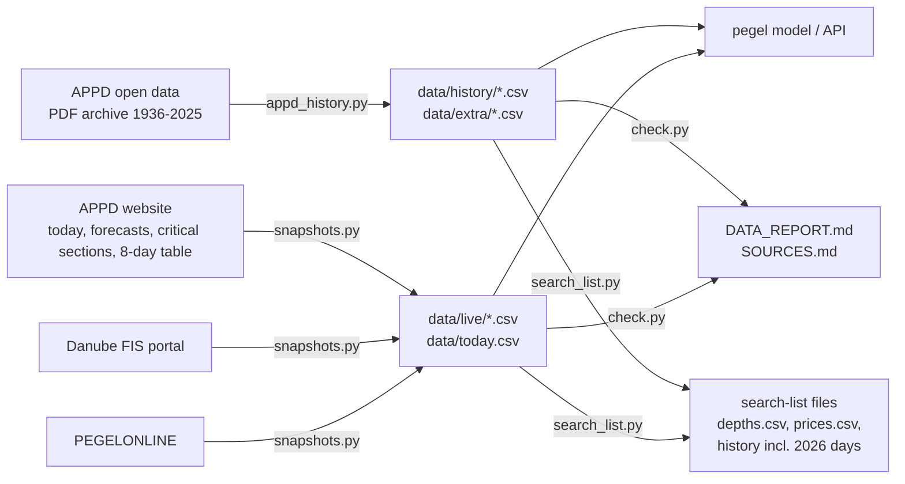

# Data sources and overview

Generated by scripts/data/check.py on 2026-10-22 17:40. Numbers below are read from the files, so re-run after every update.

## Overview

| dataset | file | period | places | rows | source |
|---|---|---|---|---|---|
| Daily water level (model input) | `data/history/<station>.csv` | 1936-01-01 .. 2026-10-22 | 12 gauges: cernavoda, corabia, giurgiu, lom, nikopol, novo_selo, oltenita, oryahovo, ruse, silistra, svishtov, zimnicea | 188.199 | APPD archive |
| Daily level + discharge + water temperature | `data/extra/appd_daily.csv` | 1936-01-01 .. 2025-12-31 | 6 gauges | 188.103 | APPD archive |
| Gauge km and gauge zero | `data/extra/appd_stations.csv` | - | 6 gauges | 6 | APPD archive |
| List of source PDFs with URL | `data/extra/appd_files.csv` | - | 6 gauges | 54 | APPD archive |
| Today's level used by the model | `data/today.csv` | 2026-10-22 | novo_selo -90 cm, vidin -59 cm, lom -44 cm, oryahovo -132 cm, nikopol -34 cm, svishtov -92 cm, ruse -140 cm, silistra -142 cm | 8 | APPD today |
| Today's readings (manual + automatic gauges) | `data/live/appd_today.csv` | 2026-10-22 .. 2026-10-22 | 12 gauges | 18 | APPD today |
| 6-day level forecast with min/max | `data/live/appd_forecasts.csv` | 2026-10-23 .. 2026-10-28 | 5 gauges | 30 | APPD forecasts |
| Depth at critical sections (today + 3 forecast days) | `data/live/appd_bottlenecks.csv` | 2026-10-22 .. 2026-10-25 | 20 sections | 80 | APPD critical sections |
| Latest level at gauges in all Danube states | `data/live/danubeportal.csv` | 2026-10-21 .. 2026-10-22 | 107 gauges | 137 | Danube FIS portal |
| Daily level along the whole Danube (8-day table) | `data/live/gauges_daily.csv` | 2026-10-15 .. 2026-10-22 | 66 gauges | 524 | APPD 8-day table |
| Daily mean level, German Danube gauges | `data/live/gauges_daily.csv` | 2026-09-22 .. 2026-10-22 | 24 gauges | 744 | PEGELONLINE |
| Depth at a critical section + same-day gauge reading (search-list format) | `data/depths.csv` | 2026-10-22 .. 2026-10-22 | 19 sections | 19 | APPD critical sections |
| Prices, barge and convoy facts with source per line (search-list format) | `data/prices.csv` | 2013 .. 2026-08-24 | 24 items | 24 | Pro Danube 2013, USM 2024, Logos Press / UkrAgroConsult 2026 |

The `data/live` files grow with every run of `snapshots.py`; the archive ends on 2025-12-31.

## Data flow

## Sources

### APPD / EAEMDR (Bulgaria)
- **Publisher:** Executive Agency "Exploration and Maintenance of the Danube River" (Изпълнителна агенция „Проучване и поддържане на река Дунав"), Ruse.
- **Archive:** <https://www.appd-bg.org/pages-en?id=opendata> - daily water level (cm), discharge (m3/s) and water temperature (degC) for Novo Selo, Lom, Oryahovo, Svishtov, Ruse, Silistra. Every PDF we used, with its URL and download date: `data/extra/appd_files.csv`.
- **Live pages:** today's readings <https://www.appd-bg.org/hidrology-en>, forecasts <https://www.appd-bg.org/forecasts-en>, critical sections <https://www.appd-bg.org/bottlenecks-en> (each row links its survey PDF), 8-day table <https://www.appd-bg.org/statistic-en>.
- **Terms (open-data page):** name EAEMDR as the source; mark modified data as modified; their name and logo may not be used commercially without written consent.
- **What we changed:** PDF and HTML tables converted to CSV; day-by-year tables turned into one row per date; depths converted from dm to cm. Values themselves are unchanged. Levels are in cm against each gauge's zero (see `appd_stations.csv`); negative values are real.
- **Caveat from APPD:** depths at critical sections are calculated from the last survey; the riverbed and buoys may have changed since the survey date.

### Danube FIS portal
- **Publisher:** the waterway administrations of the Danube states (FIS portal), <https://www.danubeportal.com/waterLevel>.
- **What we take:** the latest level per gauge with its ISRS location code and timestamp.
- **Terms:** none found on the page - ask before publishing the data in a product.
- **Caveat:** gauges belong to different countries and use different gauge zeros; compare levels only at the same gauge.

### PEGELONLINE (Germany)
- **Publisher:** Federal Waterways and Shipping Administration (WSV), <https://www.pegelonline.wsv.de/webservices/rest-api/v2>.
- **What we take:** water level W of all German Danube gauges, last 30 days, averaged to daily means by us.

### Prices and barge facts (`data/prices.csv`)
Every line names its source and date; each value was read on the source page itself. Nothing is estimated or converted (USD stays USD).
- **Pro Danube 2013** (A. Capatu, EUSDR working group, 16-17 Apr 2013): <https://navigation.danube-region.eu/content/uploads/sites/10/2019/09/2013-04-17_EUSDR_PA1A_4th_WG_Flashlight1.pdf> - convoy, payload and cost by draught, freight rates Constanta-Hungary, canal fee basis.
- **USM / UGA / Atria Brokers, 5 Feb 2024**: <https://en.usm.media/barge-freight-rates-to-constanta-have-decreased/> - barge rates Reni/Izmail to Constanta and to Ruse/Silistra.
- **Logos Press, 23 Jul 2026**: <https://logos-pres.md/en/news/freight-rates-on-the-danube-have-risen/> - ~28 USD/t Reni/Izmail-Constanta, ~2 m max draught at Cernavoda, 30-60 % capacity loss (ASAP Agri).
- **UkrAgroConsult, 17 and 24 Aug 2026**: <https://ukragroconsult.com/en/news/freight-rates-from-ukraines-danube-ports-rise-amid-critically-low-water-levels/>, <https://ukragroconsult.com/en/news/low-danube-water-levels-effectively-block-grain-exports-from-part-of-bulgaria/> - coaster rate to Egypt, truck cost Vidin region to Black Sea ports.
- **Not found (left out on purpose):** a normal barge rate Ruse/Lom-Constanta, a rail rate, convoy transit days, the depth at which barges stop, the current canal tariff.

## How to cite on slides or the website

> Water level data: EAEMDR / APPD (Bulgaria), reformatted by Pegel; Danube FIS portal; PEGELONLINE (WSV). Status: see date in the app.
